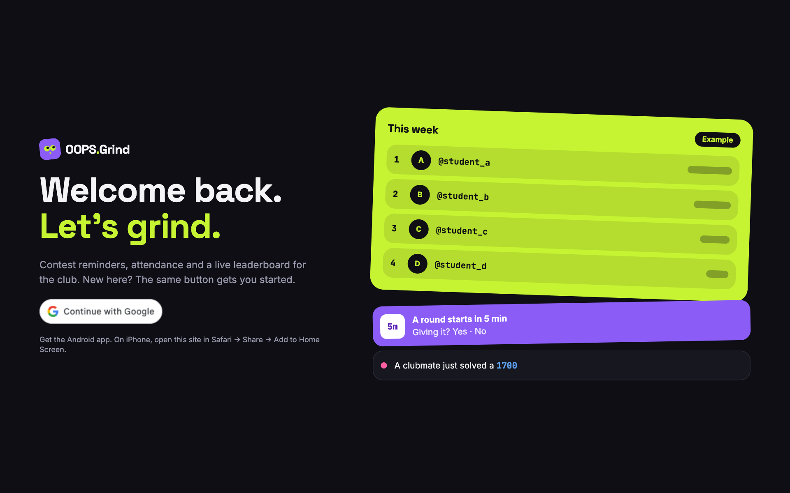

  

<h1 align="center">OOPS.Grind</h1>

  Keeps a college competitive programming club solving, together.

  <a href="https://cp-club-web.aristoncodes247.workers.dev"><b>Open the website</b></a>
  &nbsp;·&nbsp;
  <a href="https://github.com/aristoncodes/cp-club-tracker/releases/latest/download/cp-club-tracker.apk"><b>Download the Android app</b></a>

## What it is

OOPS.Grind tracks a club's Codeforces, CodeChef, LeetCode and AtCoder activity in one place, so everyone can see who is solving and who isn't.

- **Live leaderboard:** points for every solve, weighted by difficulty, by day, week and month.
- **Feed:** the club's latest solves, refreshed every minute.
- **Contest reminders:** a push an hour before, and a 5-minute "Giving it?" with Yes and No buttons.
- **Attendance:** checked automatically after each counted contest. You see your own, and coordinators see everyone's.
- **Profiles:** streaks, a solve heatmap and rating history.
- **Meal-time nudges:** four funny pushes a day, at 9 AM, 1 PM, 5 PM and 9 PM. You can turn them off.

## Get started

Sign in with Google, pick a username, add your handles, and you're in. A coordinator approves your handles once, and your solves count from then on.

**Android:** install the [APK](https://github.com/aristoncodes/cp-club-tracker/releases/latest/download/cp-club-tracker.apk).
**iPhone:** open the [website](https://cp-club-web.aristoncodes247.workers.dev) in Safari, tap Share, then Add to Home Screen.
